# YAiRO — Yet Another iRacing Overlay

Simple, lightweight overlays for iRacing and Le Mans Ultimate.
All overlays are also available to use in a browser or as an OBS browser source.

No cloud, everything free, everything open-source.

## Supported simulators

| Simulator | Setup |
|---|---|
| [iRacing](https://www.iracing.com) | Nothing to do |
| [Le Mans Ultimate](https://www.lemansultimate.com) | In LMU: `Settings → Gameplay → Enable Plugins → ON`, then restart LMU completely. The Control Center shows a hint if this is missing. |

Choose your simulator in the Control Center (section "Simulation"). Only the selected simulator is read, there is no auto-detection.

Every simulator keeps its own settings: overlay positions and sizes, enabled overlays, all overlay options (columns, scale, opacity, ...) and the target lap time. The accent color and the color correction filter are global and apply to all simulators.

In LMU, all overlays hide automatically while you are in the main menu and come back as soon as you join a session.

## Features

Features that only exist in one simulator are marked **(iRacing only)** or **(LMU only)**. Everything else works in both.

All overlays can be scaled and their background opacity can be changed.

### 🥇 Standings
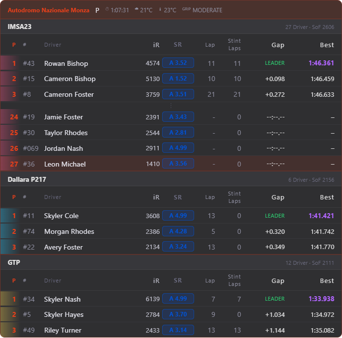

- Session info
  - Track, session type, remaining time, laps to go, air and track temperature
  - Track grip **(iRacing only)**
  - Real time clock (can be hidden)
- Multi-Class support
  - Strength of Field per class **(iRacing only)**
- Choose top cars to be displayed
- Choose cars around you to be displayed
- Car info:
  - Class-position
  - Number
  - Country flag (can be hidden)
  - Manufacturer logo (can be hidden)
  - Name
  - iRating, estimated iRating change and Safety Rating (can be hidden) **(iRacing only)**
  - Lap of cars
  - [Stint laps¹](#-stint-laps) (can be hidden)
  - Gap to leader
  - Average lap time (can be hidden)
  - Best lap time (can be hidden)
  - Last lap time (can be hidden)
  - Pit stops (can be hidden) **(LMU only)**
  - Penalty flag: a small black flag while a drive-through or stop-and-go penalty is outstanding (can be hidden). Track limit points don't count until they turn into a penalty.

### ↔️ Relative
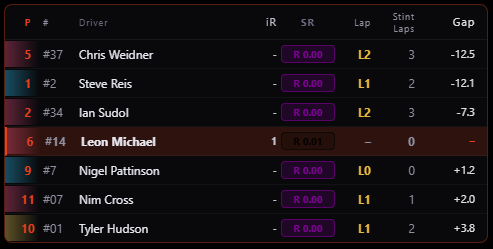

- Multi-Class support
- Choose cars around you to be displayed
- Car info:
  - Class-position
  - Number
  - Name
  - iRating and Safety Rating (can be hidden) **(iRacing only)**
  - Lap of cars
  - [Stint laps¹](#-stint-laps) (can be hidden)
  - Gap to you
  - Average lap time (can be hidden)
  - Last lap time (can be hidden)

### 📊 Telemetry
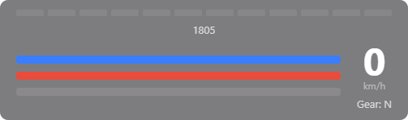

- Rev bar
- RPM as number (can be hidden)
- Input bars for clutch, brake and throttle
- Speed
- Gear

In LMU, the rev bar's shift points are approximated from the car's rev limit, because LMU doesn't provide them.
While spectating, LMU also shows the inputs and rev bar of the car you are watching **(LMU only)**.

### ⛽ Fuel
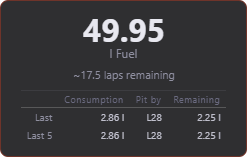

- Current fuel
- Estimated laps remaining
- Fuel consumption per lap
  - Last lap
  - Average last 5 laps
- Consumption of each of the last 5 laps (can be hidden)
- Predictions
  - Lap to pit
  - Fuel left at pitting
  - Fuel to fill at the next stop, taken from the pit menu
  - Estimated pit stop time with the current pit menu settings **(LMU only)**
  - Stops until end of race
- Virtual Energy **(LMU only)**: For cars with Virtual Energy (Hypercar, LMGT3), everything is shown in % VE instead of liters, because VE limits the stint there.
- While spectating, LMU shows the fuel or VE level of the car you are watching **(LMU only)**.

Consumption values appear after the first full lap. A lap you joined in the middle of doesn't count.

### ⏱️ Lap Timer
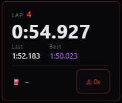

- Current lap
- Current lap time
- Delta to best lap or target lap (if set)
- Last lap time
- Best lap time
- Target lap time (only if set)
- Track limit points and the penalty limit of the server, e.g. `1.50 / 5`. Turns red one point before the limit **(LMU only)**.

### ❌ Incidents **(iRacing only)**
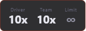

- Incidents of current driver
- Team incidents
- Incident limit (next penalty at X incidents)

LMU has no incident system, so this overlay isn't available there.

### 🗺️ Trackmap
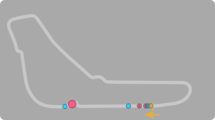

- Multi-Class support
- Cars on track
- Cars in pit
- Start/Finish line **(iRacing only)**
- Track direction **(iRacing only)**
- LMU: the official track map of the loaded layout, with the pit lane. Cars are placed by their real position on track, and the map is rotated to fill the overlay best **(LMU only)**.

### 🛞 Tires
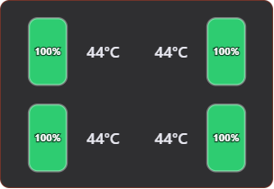

- Tire wear
  - as graphic and number (can be hidden)
- Tire temperature

iRacing only updates tire data when you are pitting.
Therefore, in iRacing the overlay is only visible in the pit lane.
LMU provides live tire data, so there the overlay is always visible while driving. While spectating it shows the watched car's tires, if LMU provides them (online, other drivers' tires are not available).

### 🏁 Flags
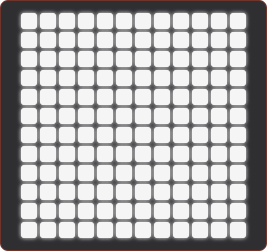

- Flags:
  - Black flag
  - Meatball flag **(iRacing only)**
  - Red flag
  - Checkered flag
  - Blue flag
  - Yellow flag (in LMU: yellow in your current or the next sector)
  - Red-Yellow (caution) flag (in LMU: Full Course Yellow / Safety Car)
  - White flag
  - Green flag

### ⏱️ Delta bar


- Delta in comparison to best lap or target lap if set
- Bar goes up to =/- 9.99 seconds
- Text can be hidden

### 💥 Damage **(LMU only)**
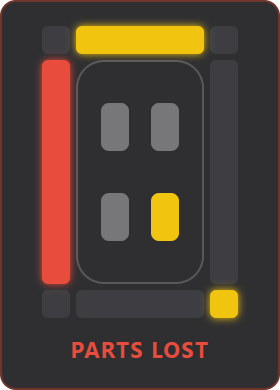

- Car seen from above with 8 damage zones (none, light, heavy)
- Wheels: flat or lost
- Warnings for overheating and lost parts
- Only for your own car, empty while spectating

### 🎨 Custom accent color
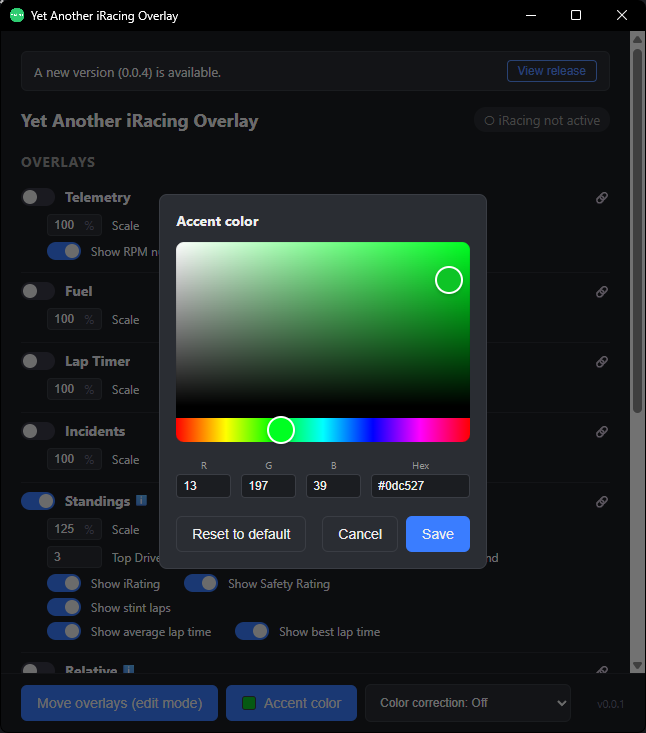

- Choose color by
  - picker
  - hex value
  - RGB value
- Reset to default orange
- Applies to all simulators

### 🔓 Accessibility

#### **Color correction filter**

- Available filter:
  - Protanopia
  - Deuteranopia
  - Tritanopia
- Affects control center and overlay-windows, using the URL (e.g. in OBS) does not apply the filter!
- Applies to all simulators

As I'm not colorblind and I don't know a colorblind person, I can't test this feature properly and relly on feedback. I would appreciate any feedback on this feature!

## Notes

### ⚠️ Stint Laps
Neither iRacing nor LMU provide this info. It is calculated internally from tracked laps.
But when the program is not running (e.g. in 24hr races when you turn off your pc) and in the meantime the car pits,
it is not tracked and the stint laps will continue to rise when you reconnect and start YAiRO.

### ⚠️ Car numbers in LMU
In LMU the car number belongs to the livery. Online, several drivers often use the same official livery, so the same number can appear more than once in the standings. This is how LMU reports it.

## Planned features

- **More Overlays** - Weather, Radar (as far as possible), ...
- **More Games** - Assetto Corsa Games, ...
- **Broadcast Overlays** - Overlays more focused on design to use in livestreams
- **Customizability** - Choose colors, fonts, reorder columns, ...

## Requirements

- Windows
- [iRacing](https://www.iracing.com) or [Le Mans Ultimate](https://www.lemansultimate.com)
- For Development: Node.js 18+

## Development and Build (WIP)

#### Install dependencies

```bash
npm install
```

#### Run the App

Run the app in normal mode:
```bash
npm run dev
```

Run the app with mockup data (works for iRacing and LMU, depending on the selected simulator):
```bash
npm run dev:mock
```

Run the app with enabled screenshot function and randomized driver names:
```bash
npm run dev:document
```

#### Utilities

Dump current iRacing SDK data into JSON
```bash
npm run dump-iracing
```

Dump current LMU shared memory data into JSON (and the LMU track maps)
```bash
npm run dump-lmu
```

Regenerate the LMU shared memory offsets after an LMU update changed its headers (needs the MSVC Build Tools)
```bash
npm run gen-lmu-offsets
```

#### Build `.exe`

```bash
npm run build:win
```

### Releases

Releases and pre-releases are both built by GitHub Actions
([`release.yml`](.github/workflows/release.yml) /
[`prerelease.yml`](.github/workflows/prerelease.yml)), triggered by pushing a
git tag. Both workflows do the same thing: sync `package.json`'s version to
the tag, build the Windows installer, and create a GitHub release with the
installer attached and a changelog generated from the commit messages since
the previous tag (grouped into Added/Changed/Fixed/Removed/Other by the
leading word of the commit subject).

Which workflow runs depends on the tag name:

- `vX.Y.Z` (e.g. `v1.2.3`) → `release.yml`, creates a normal release.
- `vX.Y.Z-preN` (e.g. `v1.2.3-pre1`) → `prerelease.yml`, creates a GitHub
  pre-release instead.

When a normal release is pushed, `release.yml` first deletes every existing
pre-release (release entry and git tag) before building the changelog. This
keeps old pre-releases from lingering around once a real release supersedes
them, and makes the release's changelog look as if the pre-releases never
existed (commits made during a pre-release phase simply show up in the next
real release's changelog instead).
